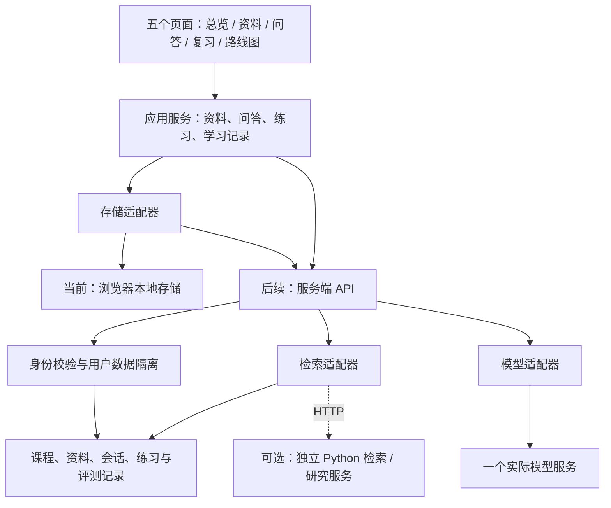

# 知序 · AI 学习工作台：架构设计

版本：0.1 · 面向渐进实现  
日期：2026 年 10 月 22 日

## 1. 架构原则与当前边界

当前版本是静态网站原型，可展示产品结构、示例流程和开发路线。浏览器本地交互用于验证体验；真实模型、检索、身份与云端数据库属于后续阶段。

采用三个可独立替换的边界：页面通过应用服务读写数据，应用服务调用存储与 AI 适配器，适配器再连接实际供应商。这样可以先以演示数据完成界面，再逐步接入真实能力。

下文中的 API、实体和目录是后续实现的设计契约，不能理解为当前都已上线。接入具体服务前，应检查其最新官方文档、可用地区与价格。

## 2. 逻辑结构



阶段 00 是当前静态原型。阶段 01（第 1–2 周）资料很小时，可以直接把选定正文放入模型上下文。阶段 02（第 3–4 周）资料变多，再使用检索适配器返回相关片段。阶段 03（第 5–7 周）形成练习与复习闭环；阶段 04（第 8 周起）按需求选择实战、协作或研究方向。周次按每周投入 8–12 小时估算，从真实功能开发起计。

## 3. 页面与模块的职责

| 页面 | 负责 | 不应直接负责 |
| --- | --- | --- |
| 总览 | 展示最近记录，提供继续学习入口 | 自行拼接模型请求或计算未经验证的掌握度 |
| 课程资料 | 添加、搜索、阅读、编辑和删除资料 | 在页面代码里处理供应商密钥 |
| 学习问答 | 选定资料范围、展示消息、引用与状态 | 信任模型给出的任意引用链接 |
| 练习复习 | 展示题目、记录作答、查看反馈与待复习项 | 把一次答对直接认定为长期掌握 |
| 项目路线图 | 展示阶段、完成标准、接入状态与文档 | 把计划功能描述为已完成能力 |

共享组件包括导航、课程切换、空状态、错误提示、加载状态、引用面板、资料选择器和反馈控件。页面状态、业务数据和演示内容应可区分。

## 4. 建议的目标目录

以下是逐步演进的逻辑目录，当前静态文件可先保持轻量；迁移时不必一次创建所有空文件。

```text
src/
├─ app/                 路由、启动、页面状态
├─ views/               五个页面
├─ components/          复用交互组件
├─ domain/              课程、资料、会话、练习的类型与校验
├─ services/            页面调用的业务用例
├─ adapters/
│  ├─ storage/          local 与远程存储
│  ├─ model/            演示与真实模型适配
│  └─ retrieval/        全文与后续检索适配
└─ data/                明确标记的演示资料
server/                 接入真实 AI 时增加
├─ routes/              HTTP 请求入口
├─ auth/                身份与权限
├─ services/            问答编排、导入与评测
└─ providers/           供应商适配、额度与重试
evals/                  版本化题集、参考证据与结果
docs/                   项目计划、接口和决策记录
```

## 5. 核心数据实体

所有实体使用稳定的字符串 ID 与创建、更新时间。示例记录应有 `isDemo` 或独立命名空间；迁移时保留版本字段。

| 实体 | 核心字段 | 关系与约束 |
| --- | --- | --- |
| Course | id、title、description | 初期只有数据结构，后续可增加课程 |
| Document／Material | id、courseId、ownerId、title、content、sourceType、version、status | 资料实体；当前原型称 note。正文变更产生新版本；保留来源与授权说明 |
| Chunk | id、materialId、materialVersion、text、startOffset、endOffset | 引用锚点与检索结果均指向实际片段 |
| Conversation | id、courseId、ownerId、title、selectedMaterialIds | 保存当时的资料范围 |
| Message | id、conversationId、role、content、status、citations、runId | 模型失败应保存失败状态，不能伪装完成 |
| Citation | materialId、materialVersion、chunkId、quote | 服务端校验片段存在与引用对应关系 |
| Question／Exercise | id、courseId、knowledgePointIds、prompt、rubric、sourceRefs、version | 练习实体；当前为固定题，后续题目与评分依据可人工复核 |
| Attempt | id、exerciseId、ownerId、answer、score、feedback、submittedAt | 记录真实作答；评分方案版本可追溯 |
| ReviewItem | id、ownerId、exerciseId、dueAt、status、reason | 可从错题人工加入，后续再推荐时间 |
| Feedback | id、messageId、ownerId、rating、comment | 不以好评替代事实正确性评估 |
| EvalCase | id、datasetVersion、question、materialVersions、expectedPoints、validChunkIds、shouldAbstain | 评测时固定资料与参考证据 |
| EvalRun／Run | id、configVersion、modelId、retrievalConfig、latencyMs、usage、status | 用于比较质量、延迟、成本与错误 |

当前原型的实际数据是 `notes`、预置问答记录 `conversations`、固定题作答 `attempts` 和计划勾选 `completedTasks`；待复习题按每题最新作答结果计算，尚无云端实体或自动复习排程。表中的用户归属、资料版本、片段、审核状态和评测运行记录是后续扩展字段。

账户接入前，`ownerId` 可由本地数据命名空间代替。账户接入后，该字段必须由服务端根据已验证身份填写，不能信任浏览器传来的用户 ID。

## 6. 应用服务与适配器契约

页面使用统一结构，不读取供应商原始响应。

```ts
type Citation = {
  materialId: string;
  materialVersion: number;
  chunkId: string;
  quote: string;
};

type AnswerResult = {
  answer: string;
  citations: Citation[];
  status: "answered" | "insufficient_evidence";
  runId: string;
};

interface MaterialRepository {
  list(courseId: string): Promise<Material[]>;
  get(id: string): Promise<Material | null>;
  save(input: MaterialInput): Promise<Material>;
  remove(id: string): Promise<void>;
}

interface RetrievalProvider {
  search(input: {
    query: string;
    materialIds: string[];
    topK: number;
  }): Promise<RetrievedChunk[]>;
}

interface ModelProvider {
  answer(input: {
    question: string;
    evidence: RetrievedChunk[];
    history: ChatMessage[];
  }): Promise<AnswerResult>;
}
```

这些是示意类型。实际实现还需补充请求取消、统一错误、超时与可观测字段。演示适配器必须固定返回演示标识；真实适配器在服务端使用，并由问答服务验证引用后再返回页面。

## 7. 后续 HTTP API 草案

| 方法与路径 | 用途 | 关键规则 |
| --- | --- | --- |
| `GET /api/courses` | 获取可访问课程 | 根据当前身份返回 |
| `GET /api/materials?courseId=...` | 列出资料 | 只返回有权读取的数据 |
| `POST /api/materials` | 导入文本资料 | 校验类型、长度、课程权限与正文 |
| `PATCH /api/materials/:id` | 更新资料 | 校验版本，重新建立片段与索引 |
| `DELETE /api/materials/:id` | 删除资料 | 同时使相关索引失效；历史引用显示资料已删除 |
| `POST /api/answers` | 根据选定资料回答 | 校验资料归属、额度和有效上下文；返回可验证引用 |
| `GET /api/conversations/:id` | 读取问答记录 | 校验会话归属 |
| `POST /api/attempts` | 保存作答 | 绑定已验证用户与题目版本 |
| `GET /api/reviews` | 获取待复习项 | 只返回当前用户的记录 |
| `POST /api/feedback` | 提交回答反馈 | 仅允许评价可访问的消息 |

统一错误结构建议为 `{ code, message, retryable, requestId }`。页面根据错误码显示可执行的下一步，不暴露密钥、完整提示词或内部异常堆栈。

## 8. 一次真实问答的数据流

1. 用户选择课程、资料并提交问题。
2. 服务端验证身份、资料归属、输入长度与调用额度。
3. 获取有效资料版本；小资料直接选取正文，后续由检索器返回相关片段。
4. 将问题、证据与有限历史交给模型适配器；资料内容作为待分析数据处理。
5. 解析统一结果，核验引用 ID、版本与片段。缺少有效依据时返回资料不足或明确的校验失败。
6. 保存消息、有效引用、运行配置和使用量；避免不必要地保存完整敏感请求。
7. 页面展示回答、依据、失败状态和反馈入口。

资料内的文字不能改变系统权限。未来加入工具调用时，每个工具使用明确的输入校验与权限范围，写入、删除和代码运行等动作按其风险单独设计确认与恢复机制。

## 9. 运行环境与渐进选型

当前静态版本采用 HTML、CSS、JavaScript 与浏览器本地存储即可。后续需要真实 AI 时增加服务端能力；Sites 的服务端运行环境是 Cloudflare Workers，适合请求编排、HTTP 调用和轻量业务逻辑。

站内数据可以按需要使用 Sites 支持的存储能力；不要在前端直连数据库或暴露数据库凭据。若采用外部数据库，优先选用有受支持 HTTP 接口的访问方式。

Python 检索实验、PyTorch 训练、GPU 推理和需要完整 Python 环境的任务，应部署为**独立服务**，由网站服务端经 HTTPS 调用。不要规划在 Sites Worker 中直接运行 PyTorch，也不要依赖原始 TCP 数据库连接。研究服务故障时，主站应能返回明确错误或使用已设计的降级路径。

引入向量数据库前，先用固定资料和题集证明现有检索不足；引入多 Agent、微调或复杂推荐前，先定义具体失败案例和可衡量的改进目标。

## 10. 密钥、身份与数据边界

- 模型密钥只存服务端环境变量或秘密管理能力，不放进 JavaScript、HTML、本地存储、Git 或下载文档。
- 浏览器请求不接受任意用户 ID 作为授权依据；服务端从会话身份得出用户范围。
- 每次读写资料、会话、作答与索引，都检查用户归属；检索阶段也必须先限定可访问资料。
- 资料发送给外部模型前，应明确实际服务商与数据流向；根据资料性质决定是否允许上传。
- 日志默认记录请求 ID、状态、配置与用量，避免保存完整敏感笔记和聊天内容。
- 支持删除与导出；删除资料时同步处理正文、索引和失效引用。
- 模型生成的 Markdown／HTML 必须按安全方式渲染，避免将未经处理的内容直接插入页面。
- 设置文件大小、上下文长度、调用频率和费用上限；重试只针对适合重试的错误，避免无限请求。

## 11. 验证与迁移

框架阶段重点人工验证导航、空状态、示例标识、移动端布局和本地数据刷新。接入真实 AI 后，增加服务边界检查、固定题集评估、引用校验、删除后不可检索、身份隔离和失败场景验证。

本地数据导出建议采用版本化 JSON：

```json
{
  "schemaVersion": 1,
  "exportedAt": "ISO-8601 timestamp",
  "courses": [],
  "materials": [],
  "conversations": [],
  "attempts": [],
  "reviews": []
}
```

迁移时先校验格式、ID、引用关系和数据大小，提供导入预览，再写入目标存储。导出文件不得包含模型密钥或服务端凭据。

每个阶段结束保留一次决策记录：本次解决的问题、采用的方案、评测结果、已知限制和下一步。该记录与源码、资料版本一起保存，便于持续开发和求职展示。
